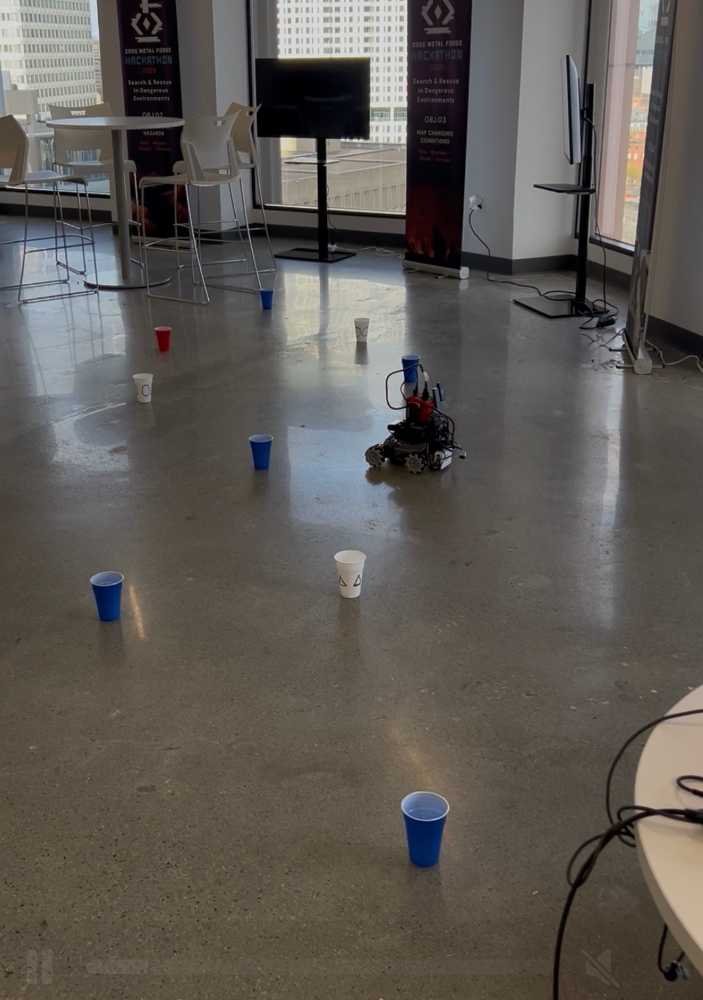
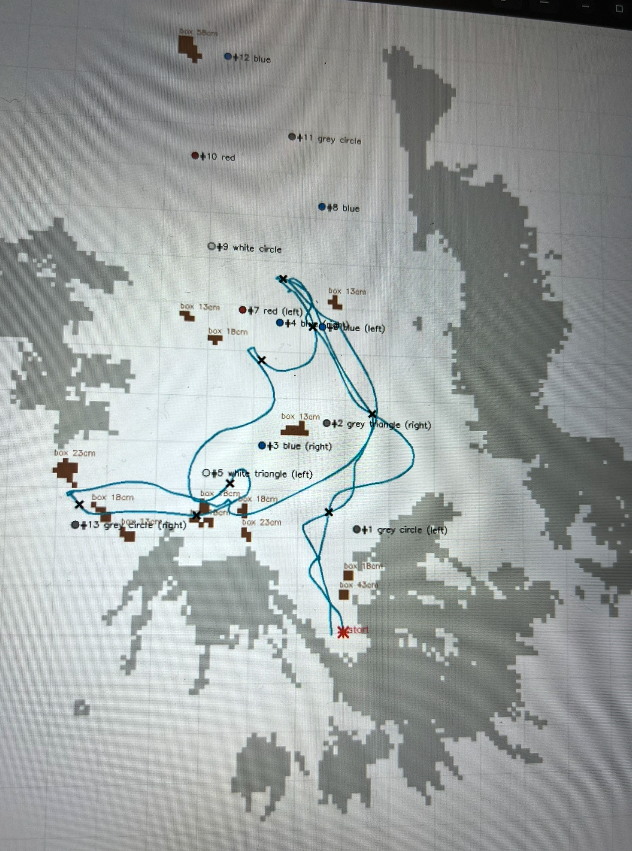

See ReadMe files in file library. Ground drone used for event. System designed to use sensor fusion and SLAM in a motor driven platform to create a full cycle autonomous system. Requires no pilot, not connectivity.

*The GHOST ground robot: mecanum base, Jetson Orin, depth camera.*

*Scan report from a real run on the test floor: route driven (blue), obstacles detected (grey and brown), cups found (red = casualty).*
