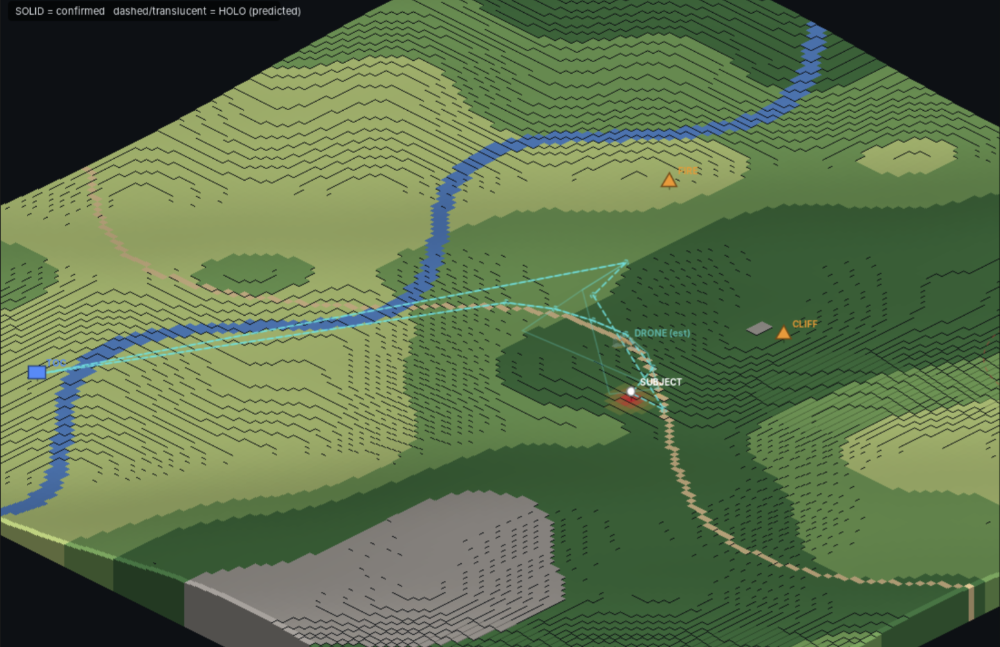
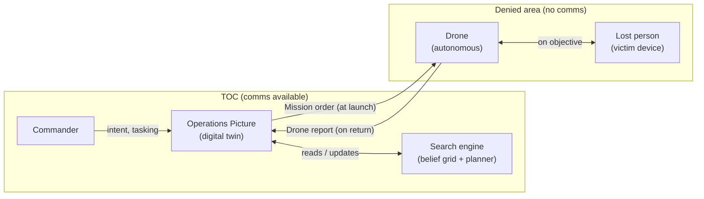
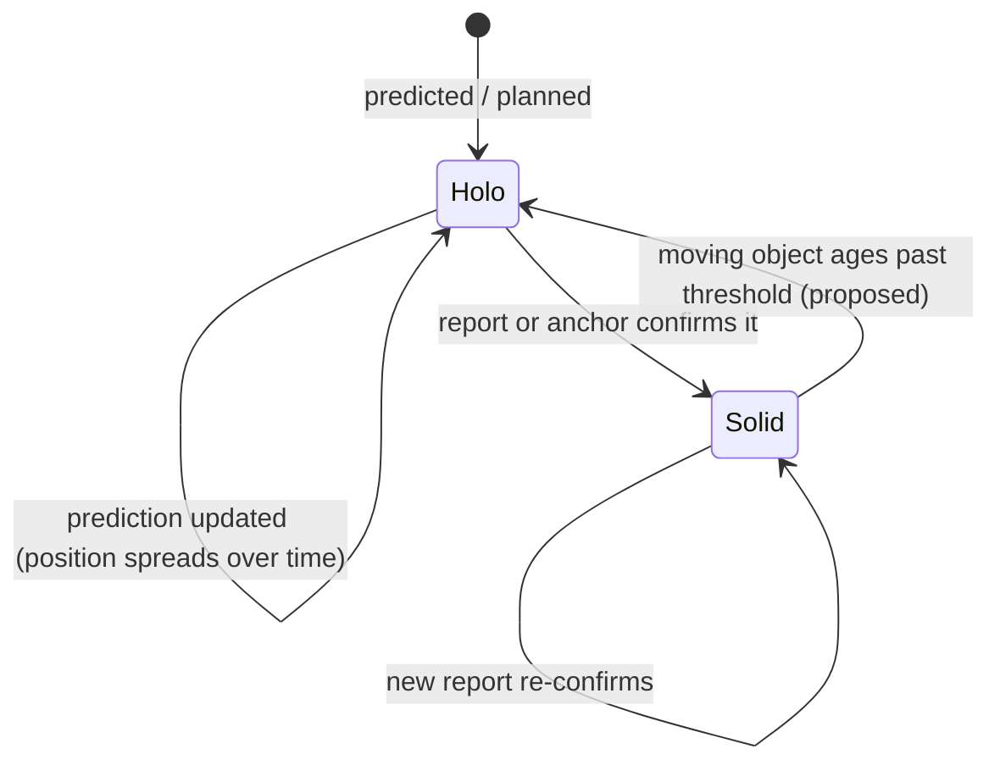
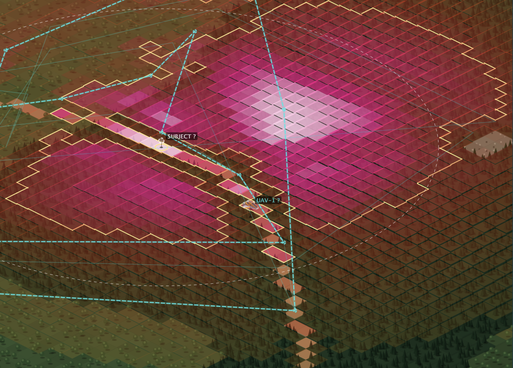
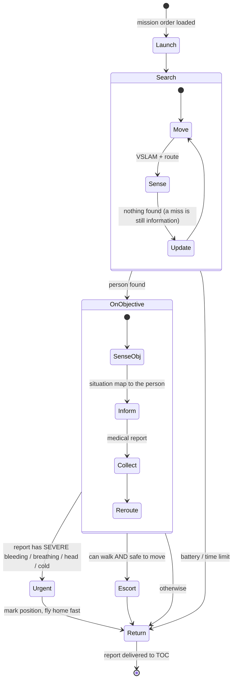
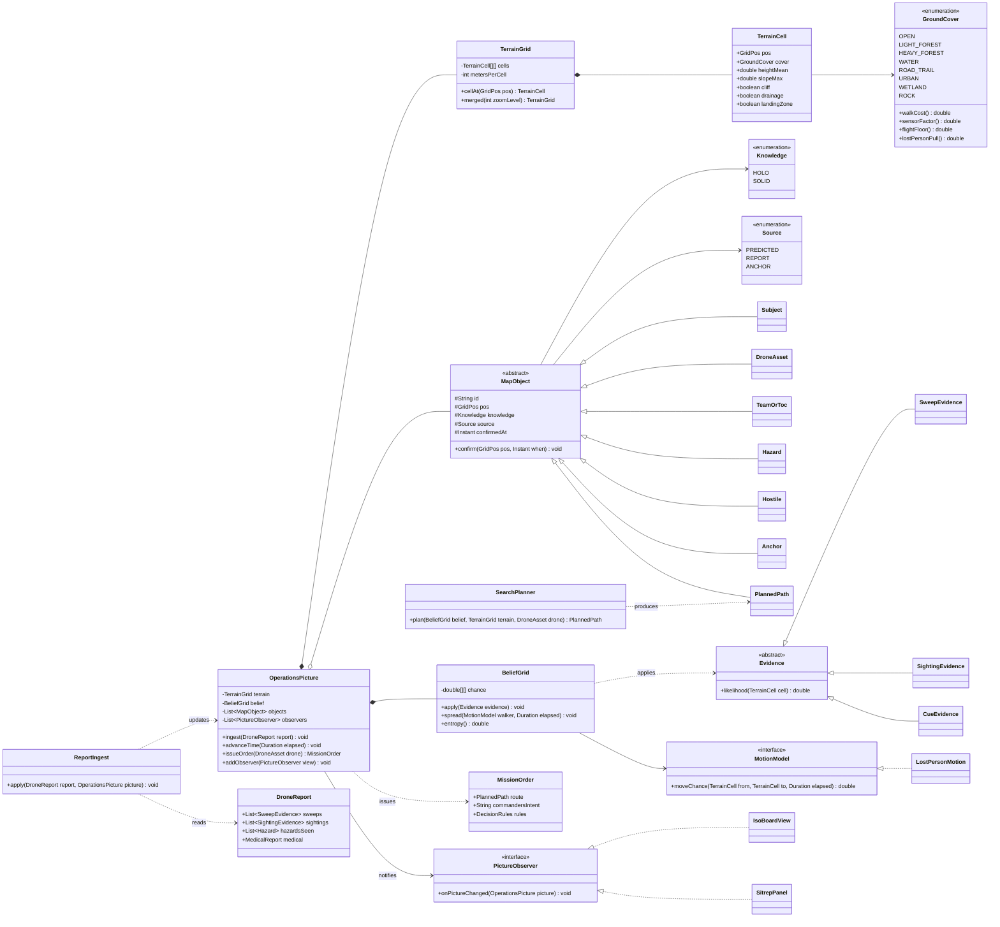
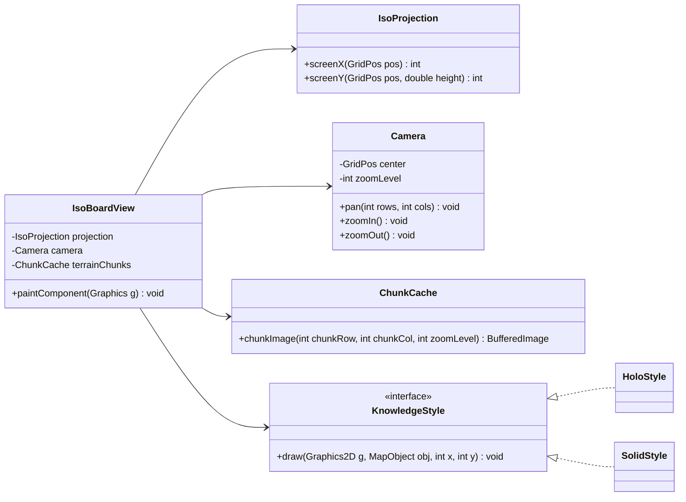
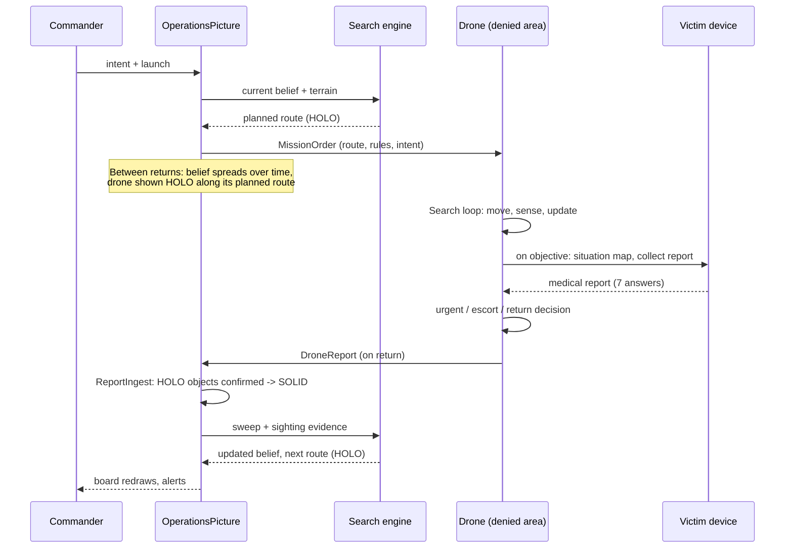

## ARCHITECTURE AND CONOP (SYSTEM AND SIM)

# C2 Operations Picture: the TOC game board

**Operation Lost and Found · Code Metal Forge 2026 · Team 20**

The command-and-control (C2) layer of the project. This is the board the commander watches at the TOC, and it is also where the search algorithm lives. It **informs** every decision the drones make, and it is **informed** by everything the drones bring home.

It underpins the demo and scaffolds the simulation engine: the same operations picture runs live missions and simulated ones.

> **Status:** design. Architecture and data contracts are defined here; implementation follows this document. Open decisions are listed at the end.

---

## 1. The operating concept

**Everything outside the TOC is comms-denied.** No GPS, no radio, no network. That single constraint drives the whole design:

- **The drone is the communication link.** It cannot transmit from the field. It collects, carries, and delivers. *Return* is the "inform the TOC" step.
- **The drone must decide on its own.** Nobody can answer it mid-mission. It launches with everything it needs: the plan, its copy of the probability map, the decision rules, and the commander's intent.
- **The TOC only knows what has come home.** Between returns, everything on the board is a prediction. The board must show the difference between *confirmed* and *predicted* at a glance.

That last point is the core display rule: **holo vs. solid** (section 3).

---


*C2 operations picture, v0.1: first end-to-end build.*


## 2. Where information flows

The operations picture sits in the middle. It is both the source of the plan and the destination of the results.



**What informs the picture:**
- **Before the mission:** terrain (prepared from imagery + elevation), the last known location, known hazards and hostiles, lost-person behavior.
- **On every drone return:** sweep coverage (where it looked and found nothing), sightings, hazards observed, the victim's medical report and position, beacon placement.

**What the picture informs:**
- **The search engine:** where the person probably is now.
- **The drone:** the next route, the decision rules, and the commander's intent, packed into a mission order at launch.
- **The commander:** the board itself, plus alerts (contact, urgent casualty, drone overdue).

---

## 3. Holo and solid: how knowledge is shown

Every object on the board is in one of two knowledge states:

| State | Means | Drawn as |
|---|---|---|
| **HOLO** | Predicted or planned: an estimated position, a set path, an expected waypoint | Translucent, outlined, faint shimmer. Paths dashed. |
| **SOLID** | Confirmed by a **report** (data a drone brought home) or an **anchor** (a fixed known reference: TOC, launch point, surveyed landmark, dropped beacon) | Full-color filled icon. Flown paths drawn as a solid trail. |

**Lifecycle of an object:**



- When a drone returns, its report **confirms** matching holo objects. They snap to solid, at the corrected position if the report differs.
- Every object carries a **source** and a **confirmed-at** time, and the board shows "last confirmed: N min ago."
- Static objects (terrain features, TOC, anchors) stay solid. Whether moving objects (the person, hostiles) fade back to holo after a set time is an open decision (section 10).

The heat map follows the same rule: it is a prediction, so it is drawn holo-style (translucent) under the solid confirmed objects.

---

## 4. The search engine lives here

The Bayesian search is not a separate box the board looks at. It runs **on the operations picture's data**, at the TOC, between drone returns.

**What it holds:**
- **Belief grid:** the probability that the person is in each square. All squares add up to 100%.

**What updates it:**
1. **Evidence from a returning drone.** Every kind of evidence answers one question: *"how likely would I see this if the person were in this square?"*
   - **Sweep with no detection:** lowers the swept squares. The amount depends on **how much of the square was actually covered** and how well the sensor sees through that ground cover (heavy canopy hides a person from thermal and cameras). A single pass through a 50 m square covers only a strip of it, so one pass must not clear the whole square.
   - **Sighting:** raises the squares around it sharply.
   - **Listener-node cues** (acoustic, direction-of-arrival): raise squares along the reported direction.
2. **Time, between returns.** The person keeps moving, so probability spreads into neighboring squares. It spreads faster along trails and downhill drainages, slower through heavy forest, and not across cliffs or open water. Terrain drives this.

**What it produces:**
- **The next planned route:** a holo path toward the squares worth the most to search, weighted by terrain cost and hazards. It goes into the next mission order.

> **Initial implementation:** the GHOST core (Rust) already implements the belief grid, likelihood-ratio updates, and an information-gain planner. The operations picture adopts it as the engine and adds what the denied concept requires: coverage-based detection, terrain-driven motion between returns, and holo/solid knowledge on everything it outputs.

---


*C2 operations picture, v0.2: terrain textures, enemy AO, stronger heat map, redesigned dashboard.*

## 5. The board: terrain and scale

### Area and grid

| Setting | Value |
|---|---|
| Area of operations | 5 × 5 miles |
| Square size | 50 m |
| Grid | **162 × 162** (162 × 50 m = 8.1 km per side) |
| Total squares | 26,244 |
| Zoom levels | 3: 50 m (≈3 km in view), 100 m (≈6 km), 200 m (whole AO, 41 × 41) |
| Tile size | 24 × 12 px isometric (2:1, AirCom's projection scaled down) |
| Terrain chunks | 6 × 6 blocks of 27 × 27 squares, pre-drawn once |
| Max drawn per frame | ~3,600 diamonds (the camera caps it) |

### What each square knows

| Kind | Fields | Made when |
|---|---|---|
| **Base** (from imagery / map) | ground cover, canopy density, road/trail, water (still / moving), structure | Once, in terrain prep |
| **Computed** (from elevation) | average height, steepest slope, **cliff flag** (dangerous or unpredictable drop), drainage, ridgeline, landing zone, radio shadow | Once, in terrain prep |
| **Live** | belief probability, searched coverage, fire, flooding, hostile presence | During the mission |

**Ground cover types (first version):** open, light forest, heavy forest, water, road/trail, urban/structure, wetland, rock. Each type carries the numbers the rest of the system uses: **walking cost**, **drone sensor factor**, **drone flight floor**, and **lost-person pull** (trails, drainages, and shelters attract; cliffs and water trap or repel).

### Terrain prep

A one-time step turns a **Google Earth capture** (colors) plus an optional **elevation file** (heights; USGS 3DEP 10 m in the US, or SRTM / Copernicus 30 m globally) into `terrain.json`. With no elevation file, heights are estimated from ground type and the board is labeled **EST TERRAIN**. Keep Google's imagery attribution visible on screen.

---

## 6. The drone's mission logic

The drone runs this on its own inside the denied area. The rules come from the mission order; nothing reaches it mid-flight.



- **The medical report picks the branch.** The victim device's 7 answers aren't just a record. They decide urgent vs. escort automatically.
- **Return is the inform step.** "Inform TOC" on the whiteboard happens on arrival, because there is no other way.

---

## 7. Architecture: lessons from AirCom

The structure follows AirCom (the isometric Java/Swing game): the model knows nothing about drawing, the projection math stands alone, and one referee object owns the truth and notifies the views.

| AirCom | C2 operations picture |
|---|---|
| `GameBoard`, "the central digital twin" | `OperationsPicture`: terrain, belief grid, every map object |
| `Cell` / `GridC` record | `TerrainCell` / `GridPos` record |
| `IsoRig` (projection math only) | `IsoProjection` (same, plus tile height from elevation) |
| `ORIGIN_X/Y` | `Camera` (pans and zooms, so the origin moves) |
| State pattern (Attack → Defense → Result) | Drone mission states (section 6) and the mission phase on the board |
| `GameObserver` as referee | `PictureObserver`: views are told when the picture changes |
| `PlayerInput` adapter | `CommandInput`: keyboard/mouse become commands; Swing stays out of the model |
| Missile arcs, intercept animation | Planned routes (holo), flown tracks (solid), return paths |

### Class diagram



### Rendering



- **Terrain is drawn once** per chunk and zoom level, into cached images. Only live layers (heat map, objects, paths) are repainted.
- **Holo vs. solid is a drawing style**, picked by the object's `knowledge`. The data never contains drawing code.
- **A small flat, north-up inset** sits beside the isometric board, because isometric views distort distances and bearings and the commander needs exact positions.

---

## 8. One mission cycle



---

## 9. Data contracts

**Victim medical report** (already produced by the victim device, `rescue_app` v0.5):

```json
{
  "app_version": "v0.5",
  "values": [0, 1, 1, 0, 2, 1, 0],
  "answers": [{"key": "bleeding", "value": 0, "label": "SEVERE"}],
  "needs_attention": ["Bleeding: SEVERE", "Breathing injury: BAD"],
  "complete": true,
  "collected_at": "2026-11-07T21:14:03"
}
```
Question order: bleeding, breathing, head, cold, walk, arms, safe to move. Values: 0 SEVERE, 1 BAD, 2 OK, 3 FINE, null skipped.

**Victim device map input** (`map_state.json`, already read by the victim device): positions in meters east/north, optional heading and background map. The operations picture writes this file into each mission order so the person sees the current picture.

**Drone report:** sweeps (path + coverage), sightings, hazards observed, beacon drops, the medical report, timestamps. *Format to be defined with the core.*

**Mission order:** planned route, decision rules (urgent/escort thresholds), commander's intent, return deadline. *Format to be defined with the core.*

---

## 10. Open decisions

1. **Aging:** do moving objects (person, hostiles) fade from solid back to holo after a set time, with a growing prediction ring?
2. **Correction ghost:** when a report puts something somewhere other than predicted, keep a faint "predicted was here" marker?
3. **Urgent branch:** can the drone leave something with the person (an IR strobe, the victim device itself), or does urgent simply mean "return now"?
4. **REROUTE** on objective: the drone re-planning its search, or directing the person somewhere safer?
5. **Overdue rule:** how late past its expected return before a drone is flagged OVERDUE?
6. **Message formats** for mission orders and drone reports, agreed with the GHOST core.

---

## 11. Related components

| Component | Role | Status |
|---|---|---|
| `rescue_app` (Pi 4B + PiTFT 2.2") | Victim device: medical questions, situation map | v0.5, running on hardware |
| GHOST core (Rust) | Belief grid, likelihood updates, planner | Running in simulation |
| GHOST dashboard (web) | Robot-view heat map and mission controls | Working |
| `pi_listener` (Pi Zero) | Acoustic baseline / anomaly logging | Written, awaiting microphones |
| AirCom (Java/Swing) | Source of the isometric rendering and pattern lessons | Reference |
