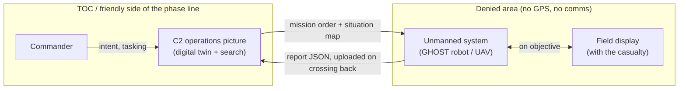
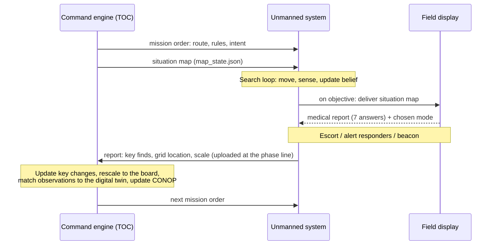
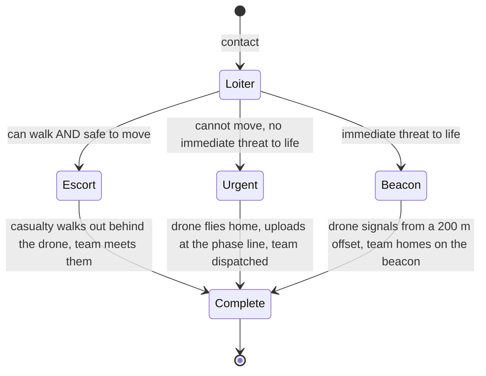
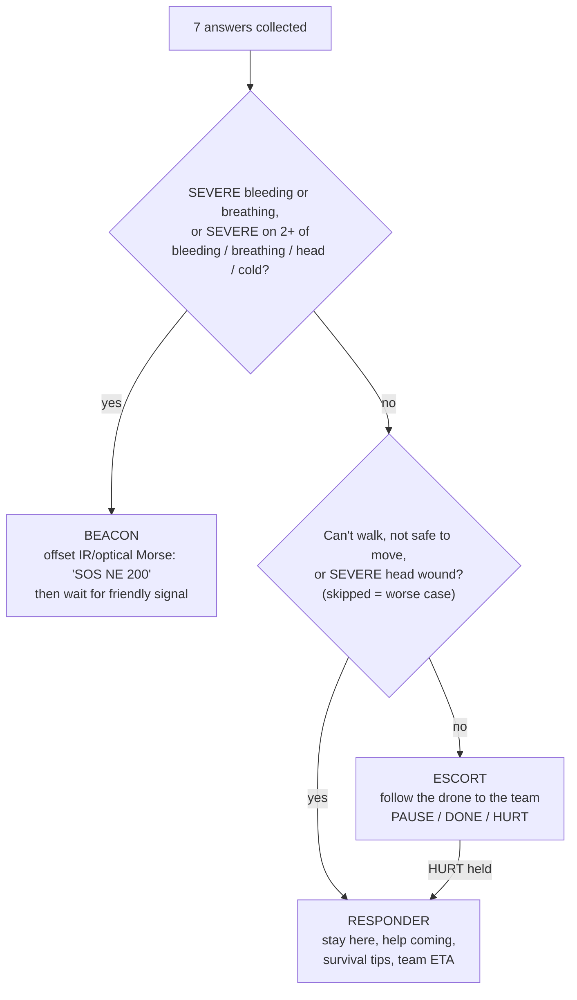
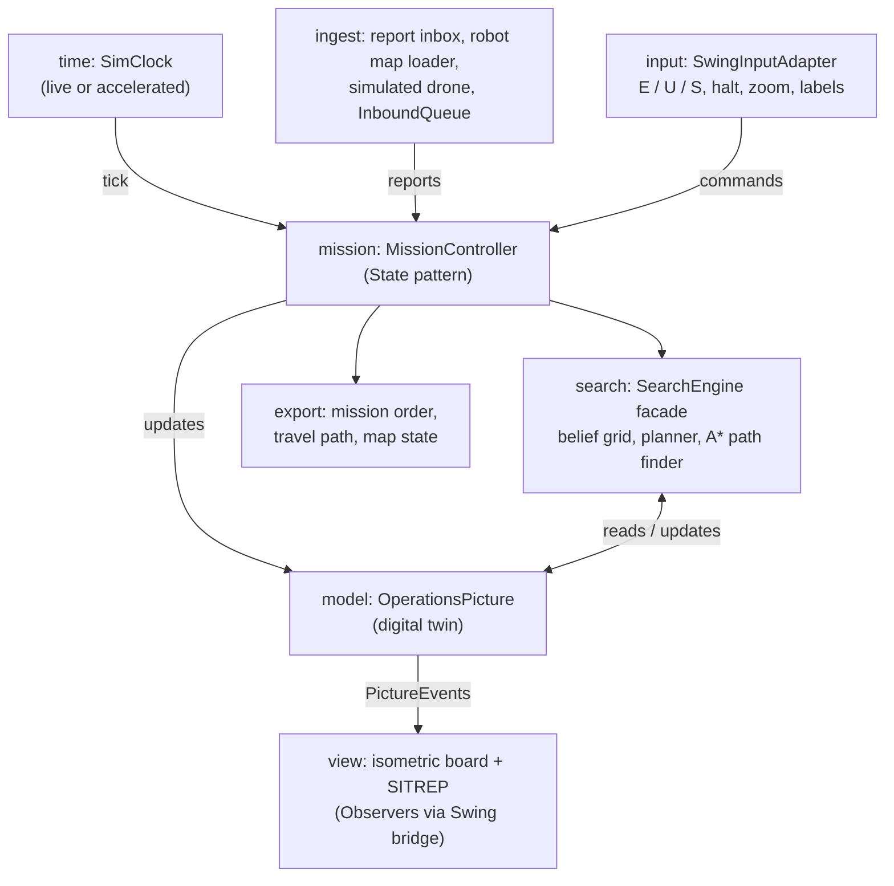
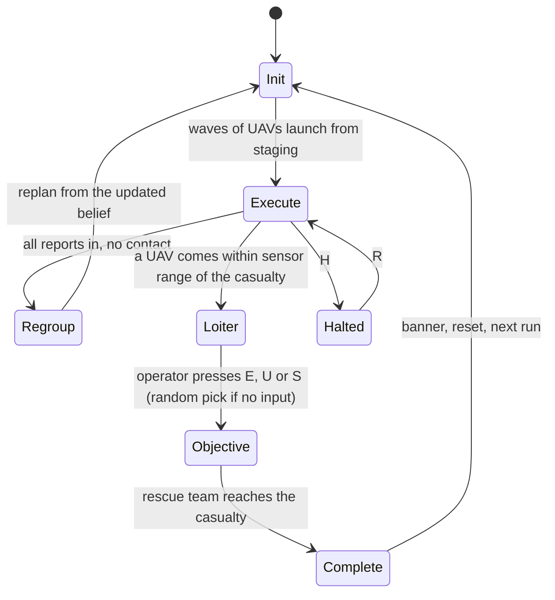
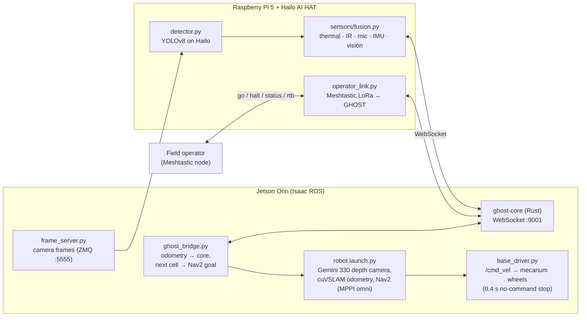

##OPERATIONS READ ME

# Unmanned Unwired Op Drone — Operation Lost and Found

**Code Metal Forge 2026 · BASE X, Boston · Nov 6–8 · Team 20**

Finding a lost person when GPS, communications, and infrastructure are gone.

The system has three parts that work as one loop:

- **GHOST**: an autonomous ground robot that searches a comms-denied area with a live Bayesian probability map, multi-sensor fusion, GPS-free navigation, and hazard avoidance.
- **The C2 operations picture**: the command engine at the TOC. A digital twin of the area of operations that plans the search, tracks what is confirmed versus predicted, and plays out the actions on the objective.
- **The field display**: a small device the unmanned system brings to the casualty. It collects a picture-based medical report, decides on the spot whether to escort, call for help, or beacon, and shows the person where help is.

---

## Commander's intent

**Purpose.** Locate and assist a lost person inside a GPS- and comms-denied area faster and more safely than a ground search alone, while keeping the rescue team aware of hazards and hostile activity.

**Key tasks.**
1. Plan the search from the best available knowledge: last known location, terrain, and how lost people move.
2. Search autonomously, with no link to the TOC once launched.
3. On contact, assess the casualty and act on the spot: escort, alert responders, or mark the location with a beacon.
4. Bring everything home and update a shared operations picture that clearly separates confirmed from predicted.

**End state.** The casualty is found, assessed, and either escorted to safety or marked for rescue. The TOC holds an accurate, confirmed picture. No assets are lost to hazards or hostiles.

---

## The problem

- **No GPS.** Everything in the field has to work out where it is from its own sensors.
- **No comms beyond the controlled area.** Nothing in the search area can send or receive. The unmanned system can't be steered mid-mission and reports only when it gets back across the line into a safe zone. **The unmanned system is the only link.** Comms are treated as a spectrum, defined per mission: fully denied, degraded, or available inside a friendly zone.
- **Limits:** weight, power, cost, connectivity. The core trade is **sensor fusion vs. power**: more sensing and onboard processing find the person faster but drain the battery faster.

---

## The system



1. **The command engine** holds the terrain, the probability map of where the person is, and every known or predicted object. It plans each route and packs it, with decision rules, the commander's intent, and the current situation map, into a mission order.
2. **The unmanned system** searches on its own: move, sense, update. On contact it goes **on objective**: loiter, assess, decide, act.
3. **The field display** asks seven picture-based medical questions, picks the point-of-contact mode from the answers, and shows the person a tactical map: their position, the rescue team, hazards, and hostiles.
4. **Back across the phase line**, the report uploads. Predicted ("holo") objects that the report confirms become solid, and the search replans.

**The display rule that ties it together:** predicted or planned things are drawn **holo** (translucent, dashed). Things confirmed by a report or a fixed anchor are drawn **solid**. In a comms-denied operation, the commander must always see the difference. Confirmed moving objects fade back to holo as their confirmation ages.

---

## Architecture and UML

### Data pipeline

Every component reads and writes a small set of JSON contracts in one shared coordinate frame.



| Contract | Made by | Read by | Holds |
|---|---|---|---|
| Mission order | Command engine | Unmanned system | Route waypoints, decision rules, commander's intent, return deadline |
| Situation map (`map_state.json`) | Command engine | Field display | Positions of the person, drone, team, hazards, hostiles (meters from the casualty); optional heading and grid |
| Medical report | Field display | Unmanned system → command engine | 7 answers (0 SEVERE – 3 FINE), needs-attention list, mode, mode reason, timestamped events |
| Drone report | Unmanned system | Command engine | Swept squares, sighting, hazards and hostiles seen, medical report, timestamps |
| Robot map (`map.txt`) | Ground robot | Command engine | Start pose, detected cups, obstacle clusters (5 cm cells, size, height), timestamped path |

### Actions on the objective

Decided in the field, at the objective, because there is no one to ask.



### Field display: mode decision



The beacon drone hovers 200 m toward the rescue team rather than over the casualty, so a visible light doesn't mark the casualty for hostiles. It sends the casualty's position relative to the light ("SOS NE 200" = the casualty is 200 m north-east of it). The person is told IR is invisible and that this is normal, then waits for the rescuers' recognition signal (3 short flashes or 3 whistles).

### Command engine structure (C2 operations picture, Java/Swing)

About 70 classes, no external libraries. Patterns adapted from AirCom: the model knows nothing about drawing, projection math stands alone, one digital twin notifies every view, and every outside format enters or leaves through an adapter.



| Pattern | Where | Why |
|---|---|---|
| Observer | Clock → controller; digital twin → views | Time and changes reach everyone who cares, nothing hardwired |
| State | Mission phases, sorties | Behavior changes by phase and over time |
| Adapter | Every file and network edge, keyboard input | Outside formats never leak into the model |
| Strategy | Detection, motion, planning, holo/solid drawing styles | Swappable rules and visuals |
| Facade | `SearchEngine` | One door into the search math (Java engine or GHOST core) |
| Records | Positions, reports, orders, events, commands | Value data that never changes after creation |

### Command engine mission loop



Control stops keep the demo clean: one contact at a time, no new waves during an objective, and a guaranteed contact by wave 2.

### GHOST robot stack (ground robot)



**GHOST decides where to search. Nav2 decides how to get there without hitting anything. The base driver turns velocity into wheel speeds.** Nothing moves until the operator presses **GO** on the dashboard or texts `go` over Meshtastic. **HALT** (button, Space, or text `halt`) stops planning, and the bridge cancels the Nav2 goal. CONTACT is published on `/ghost/contact` and sent over LoRa.

Design rationale: [ADR-0001](main/docs/adr/0001-layered-architecture.md) (Rust core / WebSocket / Python sensors).

### GHOST search math

Every grid cell starts with a Gaussian prior centered on the last known position. Each sensor vote multiplies a cell's probability by a likelihood ratio, then the grid is renormalized:

```
LR+ = Pd(dist) / Pfa                 # detection
LR− = (1 − Pd(dist)) / (1 − Pfa)     # no detection
```

When the global peak crosses **P > 0.20** with multi-sensor agreement, GHOST declares **CONTACT**. The planner scores unswept cells by `P(c) × hazard_weight(c) × sar_boost(c) / (1 + 0.08 × dist)` and routes to the best one.

| Sensor | Range | Peak Pd | Pfa |
|---|---|---|---|
| Thermal (MLX90640) | 10 m | 0.90 | 0.05 |
| IR / PIR | 3 m | 0.95 | 0.02 |
| Acoustic (voice band 85–255 Hz) | 20 m | 0.75 | 0.08 |
| Vision (YOLOv8-nano) | 15 m | 0.85 | 0.03 |

Specs are overridable at runtime through the `Config` message (indoor short-range set: `main/sensors/indoor_specs.json`).

| Hazard | Trigger | Planner weight |
|---|---|---|
| Cliff / drop | altitude rate < −0.5 m/s | 0.05 (avoid) |
| Obstacle / wall | altitude rate > +0.5 m/s | 0.10 (avoid) |
| Steep slope | lateral g > 0.30 g | 0.25 (penalize) |
| Ravine bottom | descending fast → leveling | 0.80, +50% search priority |

---

## Components

| Component | What it does | Hardware | Status | Where |
|---|---|---|---|---|
| **GHOST core** | Bayesian belief grid, sensor likelihoods, dead reckoning, hazards, info-gain planner, WebSocket server, headless sim | Jetson Orin / laptop | Running | `main/core/` |
| **GHOST sensors** | Thermal, IR, acoustic, IMU, vision fusion; hardware or stub on every module | Pi 5 + Hailo AI HAT | Running (stub and hardware) | `main/sensors/` |
| **GHOST robot** | Nav2 + cuVSLAM bring-up, mecanum base driver, frame server, core ↔ Nav2 bridge, teleop | Jetson + Gemini 330 + mecanum base | Bench-tested | `main/jetson/`, `main/bench/` |
| **Operator link** | Meshtastic LoRa commands and CONTACT alerts | Pi + Meshtastic nodes | Written | `main/pi/` |
| **Dashboard** | Live heat map, hazards, GO / HALT / RESUME / RTB / NEW SEARCH | Browser | Running | `main/dashboard/` |
| **Field display** | Medical check, point-of-contact modes, beacon, friendly signal, scenario-matched situation map | Pi 4B + Adafruit PiTFT 2.2" | **v0.8.2** on hardware | `main/drone_vic_ux/` holds v0.5 source; v0.8.2 to add (see below) |
| **C2 operations picture** | TOC command engine: isometric terrain, belief heat map, holo/solid, 2-UAV waves, phase line, actions on objective, rescue team, test-floor import | Laptop (Java 17+) | **v0.4.2 demo build** (v0.5 alternate) | to add (see below) |

---

## How the idea evolved

### 1 — The brainstorm (Day 1)


*Whiteboard: sim TOC changes and the actions-on-objective loop (Day 2).*

Framed as **"Where's Waldo?"** with a mission loop: **INFO → INIT → EXECUTE → REGROUP**. Settled on **Bayesian search** (the method behind Coast Guard search planning, so it's defensible). Split the work into "drones that move through positions" and "an algorithm that creates the travel path," with the waypoint list as the interface. Flagged **GPS-denied positioning** as the hardest problem.

### 2 — Hardware reality check

Got a **Crazyflie 2.1** flying from code over USB and Bluetooth. Without a positioning deck it can lean and climb but can't know where it is, so the team shifted to a ground robot with depth-camera odometry, and to the parts that work regardless of which vehicle flies.

### 3 — Sensing the denied area

- **Dumb nodes, smart center:** cheap nodes stream raw data back; all processing happens at one station.
- **Nature as the sensor:** wildlife and ambient sound react to anything moving through an area. Learn each location's normal, flag departures.
- **Rescuers calibrate it:** the team's own known movements are labeled examples of a person passing.
- Built **acoustic listener nodes** for five Pi Zeros: noise levels in three pitch bands, synced clocks, no audio stored.

### 4 — GHOST: the search engine

A Rust core holding the probability grid, likelihood updates from four sensor types, hazard detection, and an information-gain planner, plus a Python sensor layer and a live dashboard. The design review surfaced the next problems: repeated readings counted as new evidence, IMU-only drift, and sensor ranges far smaller than a grid square.

### 5 — GHOST on the robot

GHOST moved onto a mecanum ground robot: Jetson Orin with a Gemini 330 depth camera, **cuVSLAM** for GPS-free odometry, **Nav2** for obstacle-aware driving, YOLOv8 person detection on the Pi's Hailo AI HAT, a **Meshtastic** operator link, and a staged bench test with rehearsed stop methods ([INSTALL](main/INSTALL.md), [BENCH](main/bench/BENCH.md)).

### 6 — The field display

A Pi 4B with a PiTFT 2.2" screen, driven over SPI with only libraries already on the Pi. Versioned so every saved report traces to the code that produced it.

| Version | Change |
|---|---|
| v0.1 | First object-oriented build: 5 questions, tap to answer, hold to go back or skip, reports saved safely to JSON |
| v0.2 | Seven questions ordered most life-threatening first; new icons; version in every report |
| v0.3 | "Safe to move?" redesigned to show danger: fire, predator, hostile person |
| v0.4 | REPORT COLLECTED screen with countdown; report stamped collected; app closes |
| v0.5 | Tactical situation map: blinking military-convention symbols, range rings, compass, SITREP panel, "drone returning" countdown |
| v0.6 | **Point-of-contact modes** decided on the device: escort, responder, beacon; mode and events recorded in the report |
| v0.7 | Beacon reworked: offset IR/optical Morse with relative location; screen flash removed (would mark the casualty for hostiles); **wait for friendly signal** page |
| v0.8 | Situation map matches the command engine's scenario; finer range rings |
| v0.8.1 – v0.8.2 | Enemies moved off to the side; at most one hazard between the casualty and the rescue team |

### 7 — Designing the C2 operations picture

The central decision: **everything outside the TOC is comms-denied, so the unmanned system is the only link.** The TOC board is where the search lives: it informs the plan and is informed by every return. Board spec: 5 × 5 miles at 50 m per square (162 × 162), isometric, terrain organized with OAKOC and fed into the search itself (trails and drainages attract lost people, canopy hides them, cliffs and water block movement).

### 8 — Building the C2 operations picture

| Version | Change |
|---|---|
| v0.1 | First end-to-end build: clock, digital twin, State-pattern loop, report inbox, simulated drone, mission order / travel path / map state writers, isometric board |
| v0.2 | Satellite-style terrain with trees and textures; enemy AO with a moving patrol; stronger heat map with contour and peak ring; 4 zoom levels; redesigned dashboard |
| v0.3 | 2 UAVs per wave for readability |
| v0.4 | **Test floor built into the terrain** from the robot's `map.txt`; staging point; **phase line** with upload on crossing; **actions on objective** (loiter, E / U / S, escort / urgent / beacon); rescue team; end state and loop reset |
| v0.4.1 – v0.4.2 | Demo build: enemies moved off the middle; one hazard between the casualty and the team |
| v0.5 | Alternate cleaner look: test floor at 1:200, gentle hills, decluttered labels, L toggles labels |

### 9 — The V3 plan: closing the loop

- **Data pipeline:** the unmanned system returns key finds, grid location, and scale; the command engine updates key changes, rescales observations onto the board, matches them to the digital twin, and updates the CONOP.
- **Sim TOC changes:** add the actions-on-objective loop (escort, alert urgent, sky beacon).
- **Field display changes:** switch mode from the answers; receive map updates whose picture matches the sim.

### 10 — Sandbox: the test floor in the sim

The hackathon floor became the physical sandbox: cups on the floor (red = casualty), the ground robot driving the course, and its map (`map.txt`: obstacles at 5 cm, cups, path) imported into the command engine at a known scale. At 1:400, one robot cell lands on one board square, and the 7.5 × 5.5 m floor becomes a patch of the search area around the staging point. The robot's start becomes **staging**, and its obstacles become terrain. That's the **impose / rescale** step of the pipeline, made concrete.

---

## Repository layout

```
.
├── README.md
├── main/                       current build (GHOST on the robot)
│   ├── INSTALL.md              Jetson + Pi bring-up
│   ├── bench/                  staged bench test, preflight, stop scripts
│   ├── core/                   Rust: ghost-core (belief map, sensor model, planner,
│   │                           dead reckoning, hazards, engine, WS server, sim)
│   ├── sensors/                Python: fusion loop + thermal / IR / acoustic / IMU / vision,
│   │                           Hailo detector, indoor sensor specs
│   ├── jetson/                 ROS 2: launch, Nav2 params, base driver, motor board,
│   │                           frame server, GHOST bridge, teleop, hardware tests
│   ├── pi/                     operator link (Meshtastic), Pi + Hailo setup, models;
│   │                           files-2/ holds the field display v0.7 zip
│   ├── dashboard/index.html    live dashboard (no build step)
│   ├── docs/adr/               architecture decision records
│   └── drone_vic_ux/           field display (rescue app) v0.5 source + preview
├── core/ sensors/ jetson/      earlier GHOST snapshot (pre-robot), kept for history
│   dashboard/ docs/
└── Screenshot … 9.25.09 AM.png Day 2 whiteboard
```

**Not in this repo yet:** the **C2 operations picture** (Java) and the **field display v0.8.2**. They live on the hackathon repo's `c2-picture` branch (tags `v0.1-c2` … `v0.4.2-c2`, `v0.8.2-field`). Suggested home here: `c2-picture/` and `field-display/` at the top level.

---

## Quick start

**GHOST, simulated (no hardware):**
```bash
cd main/core && cargo run                 # core on ws://localhost:9001
cd main/sensors && python3 fusion.py      # stub sensors, auto-navigates to the subject
open main/dashboard/index.html            # live heat map
```
Headless scripted demo: `cd main/core && cargo run -- --sim`

**GHOST on the robot:** [main/INSTALL.md](main/INSTALL.md), then [main/bench/BENCH.md](main/bench/BENCH.md).

**Field display (Pi 4B + PiTFT):**
```bash
cd rescue_app && python3 main.py          # on the Pi
python3 main.py --preview                 # anywhere: renders every screen to PNG
```

**C2 operations picture (once added):**
```bash
cd c2-picture && ./run.sh                 # Java 17+; reads ./map.txt if present
```
Keys: **E** escort · **U** urgent · **S** severe · SPACE pause · +/- speed · H halt · R resume · Z/X zoom · L labels (v0.5)

---

## Hardware

| Hardware | Role |
|---|---|
| Jetson Orin Nano + Orbbec Gemini 330 + mecanum base + motor board | GHOST robot: core, cuVSLAM, Nav2 |
| Raspberry Pi 5 + Hailo AI HAT | Sensor fusion, YOLOv8 detection, operator link |
| MLX90640 · MPU-6050 · PIR · USB mic | Thermal, IMU, IR, acoustic sensing |
| Meshtastic LoRa nodes | Operator commands and CONTACT alerts |
| Raspberry Pi 4B + Adafruit PiTFT 2.2" (ILI9340, 320×240, 4 buttons) | Field display |
| Raspberry Pi Zero ×5 | Acoustic listener nodes |
| Crazyflie 2.1 | Early flight testing |
| Laptop | C2 operations picture, dashboard |

---

## Team

| Who | Focus |
|---|---|
| **Sebastian** | Systems architecture and UML, C2 operations picture, field display, project lead |
| **Jeff** | GHOST core, search algorithm and path planning, robot integration |
| **Eric** | Unmanned system movement through positions |

---

## Open items

- Bring the C2 operations picture and field display v0.8.2 into this repo.
- Connect the C2 engine to the GHOST core through the `SearchEngine` facade (a WebSocket adapter), so the board runs on GHOST's belief instead of the Java engine.
- Real terrain import (imagery + elevation → `terrain.json`) in place of generated terrain.
- Live situation-map hop: the command engine's `map_state.json` carried to the field display on each sortie.
- GHOST: coverage-based detection per cell, so repeated readings aren't counted as new evidence.
- Beacon decisions: visible vs. infrared by mission; per-mission friendly recognition signal.

---

## Credits

C2 picture drone sprite: Kenney (CC0). All other map symbols are drawn in code.
